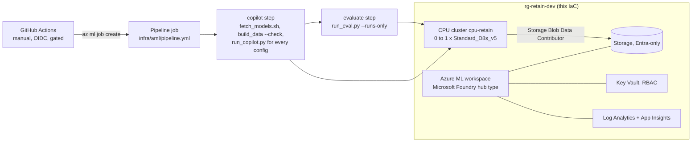

# Running the evaluation on Azure ML / Microsoft Foundry (written, not run)

Nothing here has been deployed. The IaC is checked in CI (`terraform validate` and `test` with mocked
providers, `tflint`, `checkov`, `bicep build`), and the deploy workflow is switched off.

## Target design

The pipeline runs exactly the code that runs locally: the same simulator (checked against the committed
data), the same uplift models, the same Gemma 4 E2B GGUF (pinned by revision and SHA-256) through
llama.cpp on 8 vCPUs, the same guard and the same scorer. No GPU is needed.

| Resource | Terraform | Bicep |
|---|---|---|
| Log Analytics + Application Insights | `azurerm_*` | same ARM types |
| Storage (TLS 1.2, no shared keys, no public blobs) | `azurerm_storage_account` | `Microsoft.Storage/storageAccounts` |
| Key Vault (RBAC, purge protection) | `azurerm_key_vault` | `Microsoft.KeyVault/vaults` |
| Azure ML workspace (identity access to storage) | `azapi_resource` | `workspaces` |
| CPU cluster: min 0 nodes, idle 2 minutes, no SSH, local auth off | `azapi_resource` (`computes`) | `computes` |
| Cluster identity -> Storage Blob Data Contributor on the workspace storage | `azurerm_role_assignment` | `roleAssignments` |
| Diagnostic settings (workspace, Key Vault) | `azurerm_monitor_diagnostic_setting` | `diagnosticSettings` |

## Cost before anyone says yes

Prices from the Azure Retail Prices API, pay-as-you-go, eastus2, checked 2026-11-10:

| Item | Price | One pipeline run |
|---|---|---|
| Cluster node, Standard_D8s_v5 Linux (8 vCPU, 32 GB) | $0.384 per hour | about $0.40 to $0.80 for a run of one to two hours |
| Same node as Spot | $0.110 per hour | cheaper, but the run can be evicted (it is resumable) |

The cluster idles at zero nodes, so there is no always-on compute charge. Storage, Log Analytics and
Key Vault add small monthly charges. Delete the resource group to stop all charges. Check current prices
and get approval before enabling the workflow.

## One-time setup (only if approved)

1. Entra app registration with a federated credential for this repo's `dev` environment.
2. Contributor on one resource group.
3. Repository variables `AZURE_CLIENT_ID`, `AZURE_TENANT_ID`, `AZURE_SUBSCRIPTION_ID`.
4. A required reviewer on the `dev` environment.
5. `DEPLOY_ENABLED=true`, then run **deploy** by hand.

## Planned, not built

A real desk integration: the CRM opens the copilot when a high-risk customer calls, the agent sees the
offer, talk track and the guard's verdict, and every accepted or rejected suggestion is logged for the
next campaign. A Microsoft Foundry model deployment as an alternative to the CPU model.
